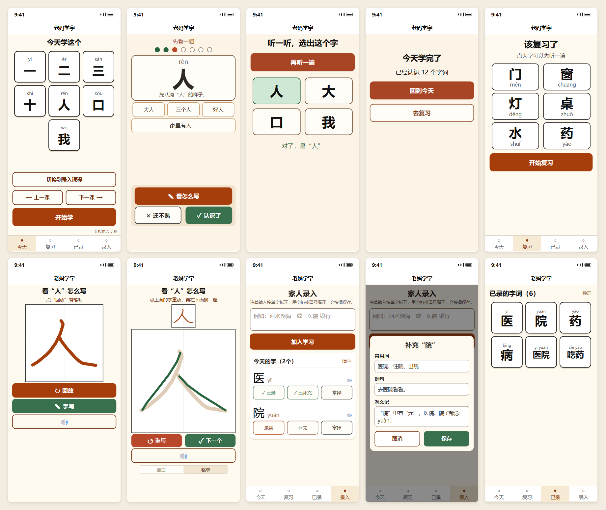

# 妈妈学认字

一款为识字较少的长辈设计的微信小程序。通过听读音、看大字卡、听音选字和间隔复习，帮助长辈学习生活中常用的字词。

## 主要功能

小程序预览：

- **家人添加学习内容**：家人可以录入常用的字或词，自动加入当天学习任务，也可以补充组词、例句和记忆提示。
- **家人录制读音**：家人可以为字词录音。播放时优先使用家人的录音，让长辈听熟悉的声音；没有录音时尝试播放内置读音，缺少读音资源时会提示家人补录。
- **方便反复学习**：默认课程共 30 课，每课 7 个新字；课程需要手动切换，不会因隔天自动换课。家人录入的内容也不会自动过期。
- **已录字词本**：家人录入且长辈已认识的字词会保存在“已录”页，方便之后快速翻看和复习。
- **手写练习**：提供笔顺动画、田字格书写和临摹模式。

## 如何使用

### 微信扫码打开

使用微信扫描下面的小程序码，即可打开小程序。

### 长辈学习

在“今天”页面点击“开始学”，按提示听读、认字；认识了就点“认识了”，还不熟就点“还不熟”。也可以在“复习”页面复习到期字词，或点字卡进入笔顺和手写练习。

### 家人录入字词和录音

1. 在底部导航栏长按“录入”3 秒，进入家人录入页面。
2. 输入汉字或词语，点击“加入学习”。连续输入的汉字会按单字拆分；用空格或逗号分隔的内容会按词保存。
3. 在当天列表中点“录音”录下家人的读音。再次录入新内容时，可以把旧内容从当天任务中拿掉；已学字词会继续保存在“已录”页。

### 开发者运行

安装[微信开发者工具](https://developers.weixin.qq.com/miniprogram/dev/devtools/download.html)，导入本项目根目录（能看到 `app.json` 的目录），使用测试号或自己的 AppID 编译运行。项目无需安装第三方依赖。

## 隐私与数据

- 无需注册或登录；学习记录、当天任务、补充内容和家人录音保存在当前设备的小程序本地存储中。
- 小程序代码不包含网络请求逻辑，数据不会上传到项目服务器。
- 更换手机、清理微信数据或卸载微信可能导致学习记录和录音丢失。
- 公开仓库不包含开发者本机配置和用户运行时录音；`project.config.json` 使用游客占位 AppID。

## 数据来源

- 笔顺数据来自 [hanzi-writer-data](https://github.com/chanind/hanzi-writer-data)，采用 MIT License。
- 拼音、组词及课程数据为项目内置离线数据。
- “昨”的离线读音截取自[“昨天”的普通话录音](https://fr.wiktionary.org/wiki/Fichier:zh-zu%C3%B3ti%C4%81n.ogg)，由 The Shtooka Project 的 Wei Gao、Vion Nicolas 制作，采用 [CC BY 2.0 France](https://creativecommons.org/licenses/by/2.0/fr/deed.en) 授权。该音频遵循原授权，不受本项目许可证覆盖。

## 许可证

本项目代码采用 [MIT License](LICENSE)。第三方数据和音频资源遵循各自的授权条款。
